# Pelikirjasto

Pelikirjasto jossa voi selata tietokannassa olevia pelejä kirjautumattomana tai user käyttäjänä.
Admin käyttäjänä katselemisen lisäksi löytyy pelin lisääminen, pelin tietojen muokkaaminen ja pelin poistaminen.

## Sovelluksen käynnistys:
./mvnw spring-boot:run --> http://localhost:8080

Tietokantana toimii H2-muistitietokanta. Testidata luodaan sovelluksen käynnistyessä ja data tyhjenee sammuessa.

## Tekniikat joita käytetty:
 Spring Boot, Spring Security, Thymeleaf, JPA, Web MVC, H2, Bean Validation, REST, JUnit

## Testitunnukset
- tunnus: admin salasana: admin

- tunnus: user salasana: user

## Screenshotit sivulta eri tapauksissa

### Kirjautumissivu

### Sivut kirjautumatta
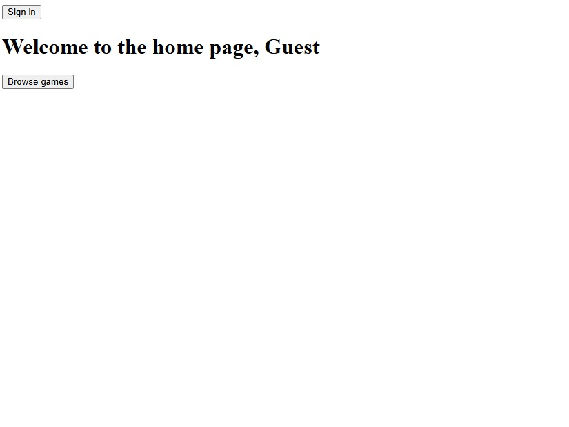
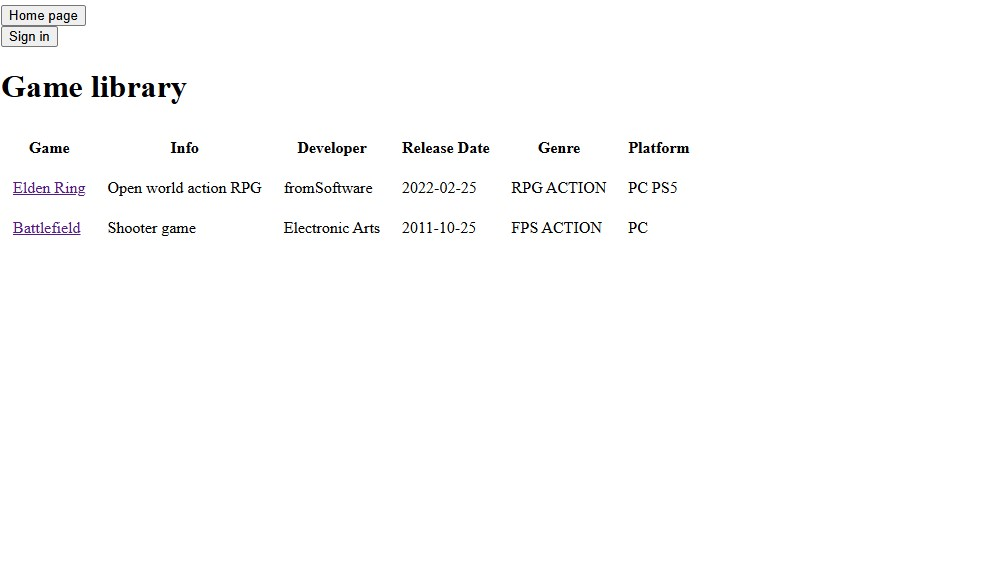
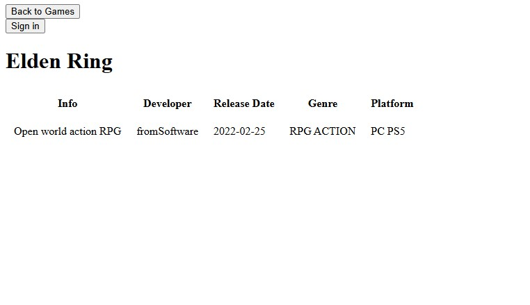

### Sivut user käyttäjänä
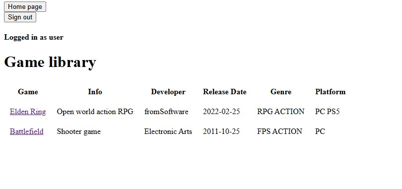
### Pelin tietosivu
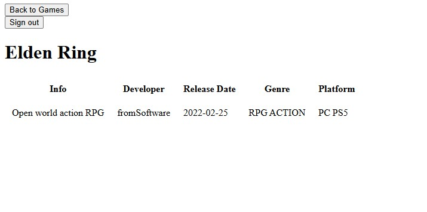
### User yrittää päästä admin sivulle
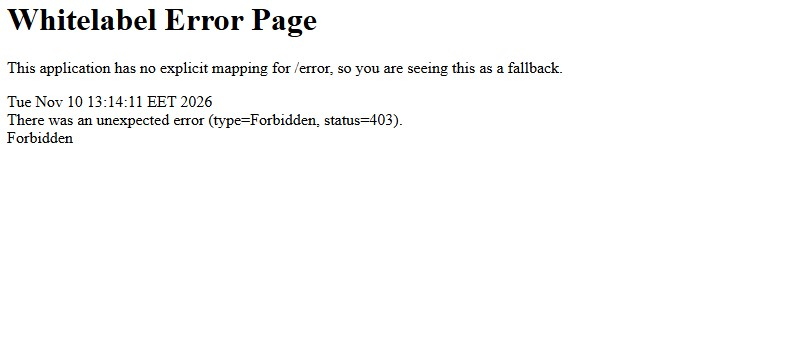

### Sivut admin käyttäjänä
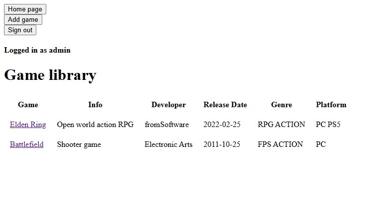
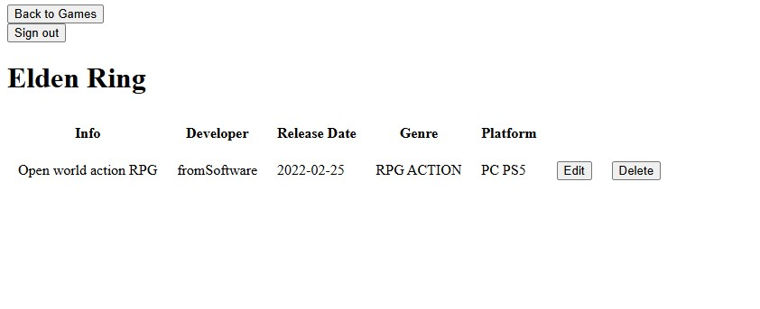
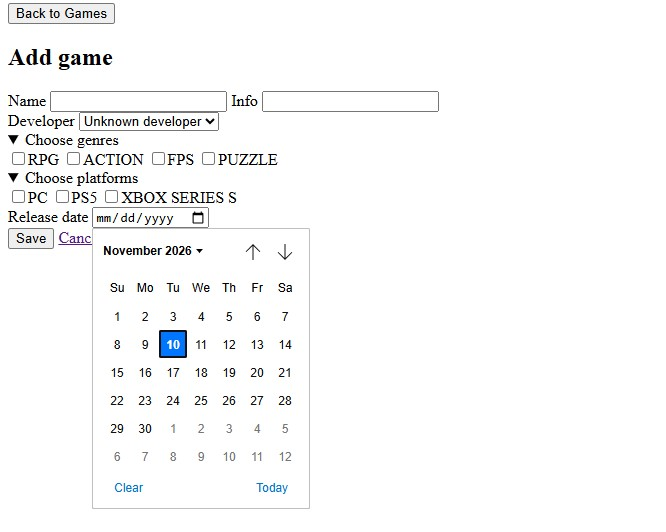
#### Liian lyhyt info annettu
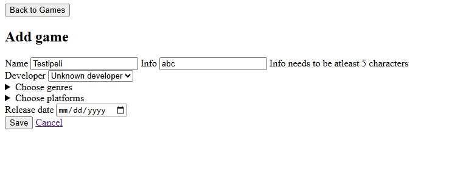
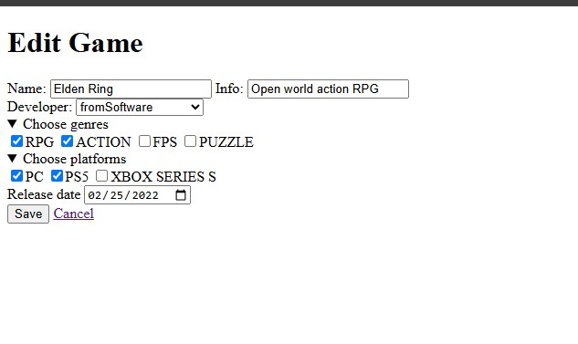

### REST
#### /api/games
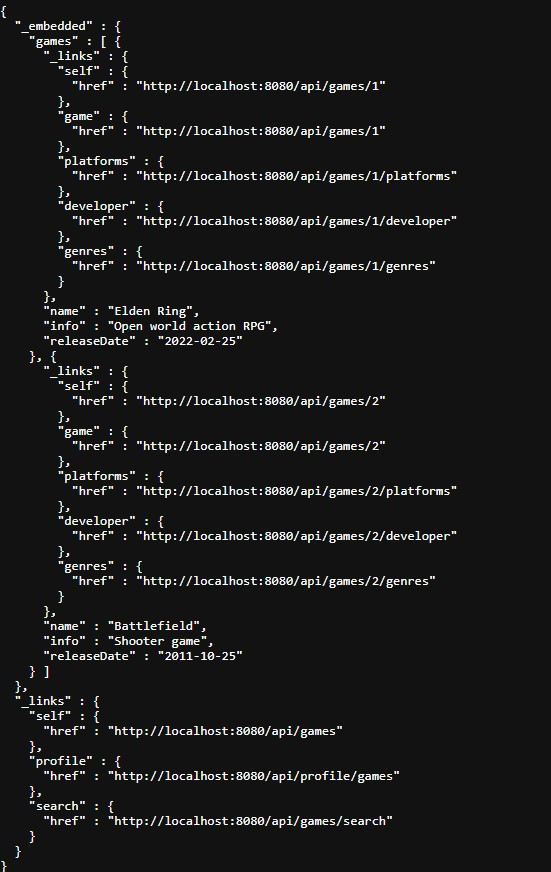
#### /allGames
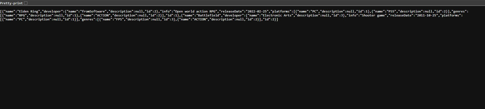

### Testit
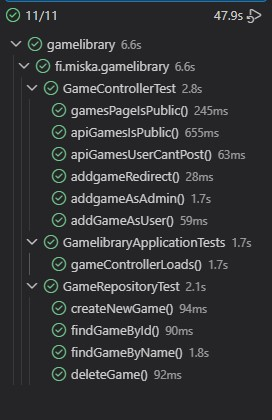